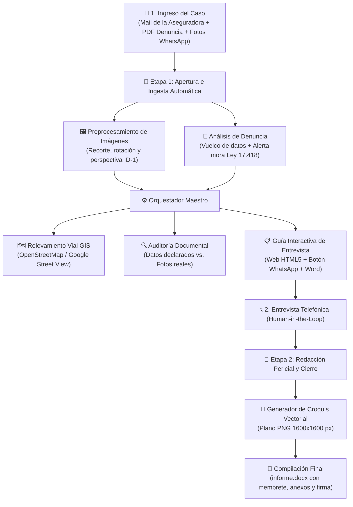
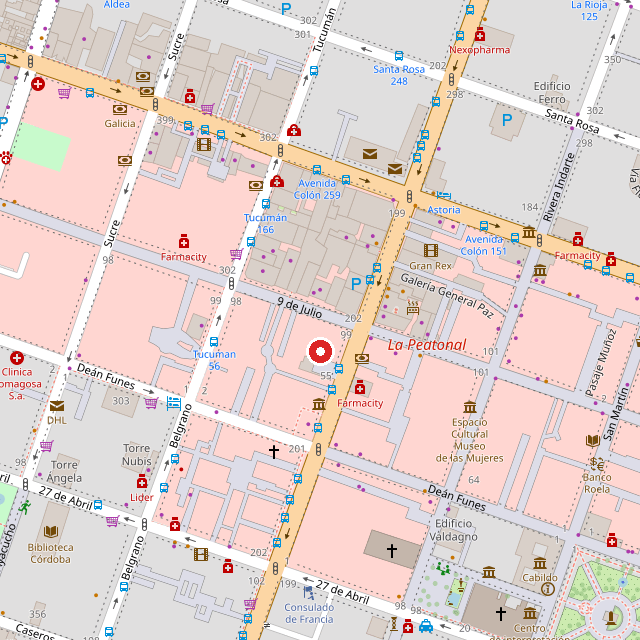
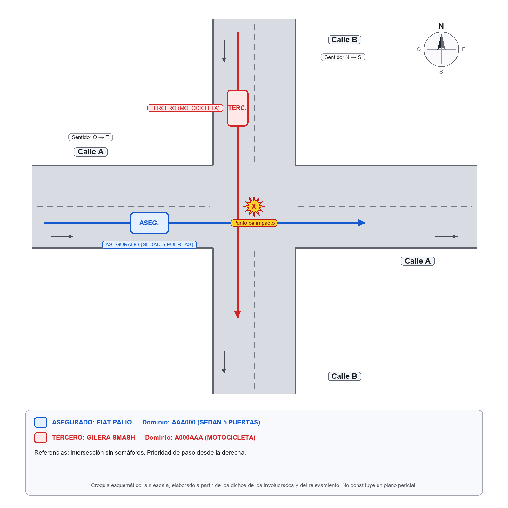

<div align="center">

# 🚗📋 Sistema de Automatización Pericial y Liquidación de Siniestros Viales

**Pipeline Híbrido: Agente de IA Multimodal + Herramientas Determinísticas en Python**

[](#)
[](#)
[](#)
[](#)
[](#)

*Automatización de punta a punta para la investigación, auditoría documental, relevamiento cartográfico y confección de informes técnicos de siniestros automotores.*

</div>

---

> [!IMPORTANT]
> **🔒 Sobre este repositorio (Showcase Público)**
> Este repositorio fue creado para presentar de forma abierta la **arquitectura, el flujo funcional y las muestras visuales** del sistema. El motor de ejecución y código fuente principal (`liquidaciones-core`) se mantienen en un **repositorio privado** por políticas de propiedad intelectual y confidencialidad en la operatoria aseguradora. Disponible para demostración técnica en entrevistas.

---

## 💡 ¿De qué trata este proyecto? (En palabras simples)

Cuando ocurre un accidente de tránsito, las compañías de seguros asignan el caso a un **estudio liquidador / pericial** para investigar qué pasó, verificar que toda la documentación esté en regla y emitir un dictamen técnico-legal.

De forma tradicional, el investigador debe hacer todo a mano:
1. Leer el PDF de la denuncia administrativa y controlar que se haya presentado en término legal.
2. Descargar decenas de fotos enviadas por WhatsApp (DNI, licencia de conducir, cédula del auto, daños), recortarlas, enderezarlas y leerlas una por una.
3. Buscar la esquina del choque en un mapa para verificar manos de circulación, semáforos y prioridades de paso.
4. Llamar a los involucrados, dibujar un croquis del accidente y maquetar todo en un documento Word formal.

### ✨ ¿Cómo lo resuelve este sistema?
Combina **lo mejor de dos mundos** bajo supervisión humana (**Human-in-the-Loop**):
- 🧠 **IA Multimodal (Visión y Lenguaje):** Lee los PDFs, interpreta las fotos de los documentos (incluso si vienen varios plásticos juntos o girados) y redacta las secciones narrativas con vocabulario técnico-pericial en tercera persona.
- ⚙️ **Python Determinístico (Precisión Exacta):** Ningún cálculo legal, validación de datos, consulta de mapas, dibujo de croquis ni maquetación de Word queda librado a la imaginación de la IA. Todo eso lo ejecutan scripts locales de Python con reglas estrictas.

---

## 🛡️ Los 3 Pilares del Diseño

| Pilar | ¿Cómo funciona en la práctica? |
| :--- | :--- |
| **1. Cero Alucinaciones** | La IA tiene prohibido inventar o suponer datos. Si un dato o fotografía aún no fue aportado, el sistema lo inserta automáticamente como `A COMPLETAR` resaltado en amarillo en el Word y lo lista en `pendientes.txt`. |
| **2. Auditoría a Doble Ciego** | Cuando el sistema revisa las fotos de DNI, cédula o licencia, transcribe en un archivo separado (`extraido_fotos.json`) **únicamente lo que llega a leer en la imagen**, sin mirar los datos declarados en la denuncia (`datos.json`). Luego, un motor en Python cruza ambos archivos para detectar contradicciones, carnets vencidos a la fecha del siniestro o patentes mal cargadas. |
| **3. Procesamiento Local Determinístico** | El recorte y rectificación de perspectiva de imágenes, las consultas geoespaciales a OpenStreetMap/Google Maps, el trazado vectorial del croquis y el armado del archivo `.docx` corren íntegramente en Python local. |

---

## 🔄 Flujo de Trabajo Operativo (En 2 Etapas)



---

## 🖼️ Muestras Reales de Salida del Sistema

### 1. Relevamiento Cartográfico y Croquis Vectorial Automático
A partir de la dirección del siniestro y el sentido de circulación de los vehículos, el sistema consulta la topología vial en **OpenStreetMap** y dibuja de forma **100% programática** el plano esquemático de la mecánica del accidente:

| 🗺️ Mapa de Intersección (OpenStreetMap) | 📐 Croquis Esquemático Vectorial (`1600×1600 px`) |
| :---: | :---: |
|  |  |
| *Ensamblado automático de teselas OSM con marcador del hecho y extracción de manos, carriles y semáforos.* | *Trazado automático de calzadas, rosa de los vientos, trayectorias (asegurado en azul, tercero en rojo) y punto de impacto.* |

---

### 2. Reporte del Motor de Auditoría Documental (Doble Ciego)
Ejemplo real de la salida en consola y en archivo (`validacion_fotos.txt`) cuando el motor determinístico compara los datos declarados contra lo leído en las fotografías:

```text
=== VALIDACIÓN DE DATOS VS. FOTOS: ejemplo-001 ===

1. DISCREPANCIAS DETECTADAS (2):
   [DISCREPANCIA] DNI Conductor Asegurado (conductor_asegurado.dni vs 04_dni_asegurado.dni):
                  datos.json tiene '00000000' pero la foto muestra '99.999.999'
   [DISCREPANCIA] CONTRADICCIÓN ENTRE FOTOS - DNI Asegurado (DNI vs Licencia):
                  04_dni_asegurado.dni='99.999.999' vs 03_licencia_asegurado.dni='00.000.000'

2. DATOS VALIDADOS CORRECTAMENTE (22):
   [OK] Dominio Vehículo Asegurado (vehiculo_asegurado.dominio <-> 02_cedula_asegurado.dominio):
        Dominio 'AAA000' verificado [Auto (formato anterior LLLNNN)]
   [OK] Dominio Vehículo Tercero (vehiculo_tercero.dominio <-> 05_tercero.dominio_visible):
        Dominio 'A000AAA' verificado [Moto Mercosur (LNNNLLL)]
   [OK] Vigencia temporal de licencia verificada:
        vencimiento (2028-08-15) >= fecha del siniestro (2026-11-01)

3. DATOS VISIBLES EN FOTOS NO CARGADOS EN DATOS.JSON (2):
   [PARA COMPLETAR] DNI Conductor Tercero: en foto se leyó -> 07_dni_asegurado.dni='38.123.456'
   [PARA COMPLETAR] Domicilio Conductor Tercero: en foto se leyó -> 'Av. Colón 500, Córdoba'
```

---

## 🧩 Arquitectura Modular del Core (`Python`)

El núcleo privado del proyecto está dividido en módulos independientes de consola:

- **`actualizar_caso.py` (Orquestador Maestro):** Inicializa la estructura estandarizada del expediente (`01_asegurado` a `09_croquis`), inyecta valores por defecto desde `.env` y ejecuta todos los módulos en secuencia sin interrumpirse si algún dato opcional aún está pendiente.
- **`preparar_foto_doc.py` (Procesador de Imágenes Documentales):** Basado en `Pillow`. Permite separar múltiples documentos fotografiados en una misma hoja, aplicar **rectificación homográfica de perspectiva de 4 esquinas** llevada al estándar internacional **ISO/IEC 7810 ID-1** (proporción física de DNI/Licencia/Cédula), rotar en ángulos finos (`--deskew`), recortar capturas de *Mi Argentina* (`--auto-trim`) y superponer grillas graduadas de calibración.
- **`procesar_denuncia.py` (Analizador Legal y Administrativo):** Limpia cortes tipográficos del PDF de denuncia, vuelca datos objetivos sin pisar ediciones humanas, calcula alertas de **mora legal (Art. 46 Ley 17.418)** y redacta el relato preliminar.
- **`validar_fotos.py` (Auditor Documental):** Normaliza DNI/CUIT, nombres y domicilios; valida expresiones regulares de patentes argentinas (Mercosur y formato anterior, autos y motos) y comprueba la vigencia de la licencia de conducir al día exacto del hecho.
- **`contexto_lugar.py` (Geolocalización Dual OSM / Google Maps):**
  - *Modo Gratuito (`SOLO_OSM_GRATUITO`):* Sin requerir API Key, localiza el nodo exacto donde se cruzan dos calles usando Nominatim + la API oficial de OpenStreetMap (`api/0.6/map.json`) y Overpass QL, calculando rumbos cardinales (`norte-sur` / `este-oeste`), sentido de circulación (`oneway`), pavimento, carriles y semáforos.
  - *Modo Google Maps:* Con `GOOGLE_MAPS_API_KEY`, descarga además vista satelital y las 4 vistas cardinales (`0°`, `90°`, `180°`, `270°`) de **Google Street View**.
- **`generar_guia.py` (Interfaz Interactiva para Entrevista):** Construye una web autocontenida (`guia_entrevista.html`) con semáforo de documentación, galería con *lightbox*, link a Google Maps, **botón directo a WhatsApp (`wa.me`) con mensaje pre-armado pidiendo las fotos faltantes** y autoguardado en `localStorage`, además de su versión imprimible en Word (`guia_entrevista.docx`).
- **`croquis.py` (Motor Gráfico Planimétrico):** Renderiza en `Pillow` el plano vectorial de la intersección, las manos de cada arteria, las trayectorias rectas o de giro y el punto de impacto.
- **`armar_informe.py` (Compilador OpenXML `.docx`):** Ensambla el informe pericial definitivo sobre `python-docx` respetando el membrete del estudio, tablas de vehículos, fotografías ordenadas, narrativa pericial, croquis y firma.
- **`aprender_modelos.py` (Extractor de Estilo Pericial):** Procesa informes históricos del estudio para mantener el léxico técnico-jurídico en nuevos casos.

---

## 🧰 Stack Tecnológico

- **Lenguaje Principal:** Python 3.10+ (uso intensivo de librería estándar + tipado de estructuras JSON).
- **Visión y Procesamiento Gráfico:** `Pillow (PIL)` (transformaciones proyectivas, filtros de nitidez, dibujo vectorial 2D).
- **Automatización Documental:** `python-docx` (manipulación directa de nodos OpenXML `w:tblBorders`, saltos y estilos).
- **Geolocalización y Cartografía:** OpenStreetMap API v0.6, Overpass API, Nominatim, Google Maps Platform (Geocoding, Static Maps, Street View Static API).
- **Interfaz de Usuario Operativa:** HTML5, CSS3 (diseño responsivo + hojas de estilo de impresión `@media print`), JavaScript Vanilla (`localStorage`, Clipboard API, WhatsApp Deep Linking).
- **Integración con IA:** Workflows guiados para Agentes Multimodales con validación determinística.

---

<div align="center">

📫 **Contacto:** [Maximo Leandro Young](https://github.com/Maxiyoung)

</div>
